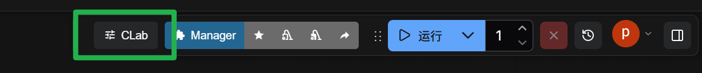

# ComfyUI-CreativeLab (CLab)

CLab (Creative Lab) 是一个为 ComfyUI 打造的卡片化任务管理面板。通过任务卡片和输入、输出模块，可以在保留工作流连线的情况下，管理、克隆和批量运行多组任务与参数。

https://github.com/user-attachments/assets/535a99a4-1c8a-4c2e-94d2-b4aabb8171ce

---

## 💡 如何打开插件？

- **快捷键**：按下键盘上的 `C` 键（可在设置中自定义）。
- **界面入口**：点击 ComfyUI 顶部主菜单栏右侧的 **CLab** 图标按钮。

    

---
## 🗂️ 工作区与通道

`工作区` 和 `通道` 是 CLab 的双层组织结构：

- **工作区**：类似PS文件切换，管理不同的“任务卡片、模块”。
- **通道**：在同一工作区内管理“多套参数绑定方案”。不改卡片结构，只切换这套卡片的绑定配置（节点/参数映射）。
- 每个**工作区**都有各自的**通道**。

常用操作：

1. **新建**：点击标签栏末尾的 `+` 新建工作区/通道。
2. **重命名**：双击标签文字可直接重命名。
3. **右键菜单**：支持新建、复制、重命名、删除。
4. **多选**：`Ctrl/Cmd` 点选多标签，`Shift` 区间多选。
5. **拖拽排序**：支持拖拽重排标签顺序（多选后也可批量移动）。

保存与恢复：

- 先通过工具栏创建配置锚点，再保存工作流（`Ctrl+S`），工作区、通道和面板数据才会一起保存。
- 重新打开工作流时，会自动恢复到上次的工作区/通道结构与状态。

---
## 🏷️ 任务卡片

https://github.com/user-attachments/assets/95d58bab-34d8-4d13-a61b-6de866037679

### 新建任务

- **未选中内容：** 在任务列表末尾添加卡片。
- **选中卡片或模块：** 在对应卡片后添加新卡片，并自动选中新卡片。

### 选择、移动与删除

- **选择：** 单击选择卡片，`Ctrl/Cmd` 点选可加选。
- **移动：** 拖拽调整顺序，放到目标卡片左半边时插到前面，右半边时插到后面；支持多选批量移动。
- **拖拽克隆：** 拖拽时按住 `Alt`，松开鼠标后创建副本，保留模块、绑定、参数值和生成记录，并选中新卡片。
- **删除：** 悬停后点击右上角的 `✖`；多选时可批量删除。

### 标题与进度

- **标题：** 默认为 `#1`、`#2`、`#3`，可点击修改。新建、删除和排序后，默认序号自动更新。
- **进度：** 运行后显示等待和执行进度，报错时变红并显示提示。
- **异常阻断：** 开启后停止本次批次的后续任务；关闭后跳过出错任务继续运行。

### 任务卡片工具栏

- **克隆：** 复制所选卡片的模块、设置、参数值和生成记录，副本插在所选卡片之后；支持批量克隆。
- **格式刷：** 复制卡片的模块结构、设置和绑定，生成记录不随格式刷复制。
    - **点击空白处：** 创建卡片，并带入源卡片的参数值。
    - **点击已有卡片：** 覆盖结构和绑定，保留目标已有的参数值；补充的新模块使用源参数值。（覆盖功能待完善）

---

## 🧩 模块

https://github.com/user-attachments/assets/f662718d-4038-4678-b940-f737c8bb4d5b

### 新建模块

- **选中卡片：** 在卡片末尾添加模块；支持多选卡片批量添加。
- **选中模块：** 在每个所选模块下方添加新模块；支持跨卡片批量添加。

### 选择、移动与删除

- **选择：** 单击模块选中，包括点击输入框；`Ctrl/Cmd` 点选可加选。
- **矩阵连选：** 按住 `Shift` 跨卡片连选相同类型的模块。例如，从卡片 1 的模块 2 连选到卡片 4 的模块 4，会选中这些卡片中第 2～4 个位置上与起始模块类型相同的模块。
- **卡片内移动：** 拖拽调整模块顺序。跨卡片多选后，在原卡片内移动其中一个模块，其他所选模块在各自卡片内同步移动。
- **跨卡片移动：** 将所选模块拖入另一张卡片，集中插入到目标位置。
- **拖拽克隆：** 拖拽时按住 `Alt` 创建副本，保留参数、绑定和生成记录，并选中新模块。
- **删除：** 悬停后点击右上角的 `✖`；多选时可批量删除。

### 模块类型

通过工具栏切换输入或输出模块。

**工具栏**

- **克隆：** 复制所选模块的设置、参数、绑定和生成记录。
- **格式刷：** 复制模块设置和绑定，覆盖已有模块时保留目标参数值。
- **重置：** 清除所选同类型模块的节点和参数绑定，恢复默认显示设置，保留输入值和生成记录。
- **同步参数：** 将当前模块的绑定和显示设置同步到标题、类型相同的模块，保留目标各自的输入值与生成记录。未命名模块按同类型默认序号（如 `##1`）匹配。
- **输入模块专属**
    - **参数框高度适配：** 文本框根据内容自动撑开；图片、视频上传区按媒体比例显示。
- **输出模块专属**
    - **尺寸与显示：** 调整预览比例、宽高、显示方式和匹配媒体比例。
    - **管理生成记录：** 打开历史记录网格，选择、排序或移除记录。

**输入模块**

- **标题：** 默认为 `##1`、`##2`，可点击修改。
- **绑定摘要：** 左键点击摘要，打开绑定面板。
    - 显示“节点数 · 参数数”或“未绑定”，悬停查看完整信息。
    - **绑定设置面板：**
        - 支持绑定多个节点的不同参数，模块值会应用到这些参数。
        - 点击节点行，查看并高亮对应的参数分组。
        - 勾选或取消勾选复选框，绑定或解绑节点、参数。
        - **[拾取节点](#拾取模式)：** 点击进入拾取节点模式。
- **参数值：** 在运行时传递给绑定参数。（注：在绑定后，各模块已有的手动输入值分别保留。）
- **媒体文件上传：** 绑定支持上传的参数后，显示上传区。
    - **支持类型：** 图片、视频、音频、3D 模型或通用文件。
    - **拖拽上传：** 将文件拖入上传区。
    - **按钮上传：** 点击上传按钮，选择文件。
    - **粘贴上传：** 选中模块后粘贴剪贴板中的文件。
    - **已有文件：** 节点提供文件列表时，可从中选择。
- **媒体预览与清除：**
    - **预览开关：** 标题旁的“查看图片 / 视频 / 音频 / 3D”默认关闭，开启后才加载预览；按模块保存开关状态。
    - **收起预览：** 仅保留文件选项框、上传和清除按钮；仍可拖拽或粘贴上传。关闭预览会停止播放并释放预览资源。
    - **清除：** 清除模块当前的文件选择。

**输出模块**

鼠标悬停模块后，可通过右上角的齿轮调整尺寸，或点击绑定摘要管理节点。

- **标题：** 默认为 `##1`、`##2`，可点击修改。
- **绑定摘要：** 左键点击摘要，打开绑定面板。
    - 显示 `[节点编号]` 或“未绑定”，悬停查看节点名称。
    - **绑定设置面板：**
        - 仅可绑定一个节点。
        - 节点列表保持原有顺序，打开面板时定位到当前绑定节点。
        - 点击其他节点切换绑定，再次点击已选节点取消绑定。
        - **[拾取节点](#拾取模式)：** 点击进入拾取节点模式。
- **尺寸与显示：**
    - **显示方式：**
        - **显示全部：** 完整显示媒体，比例不一致时留白。
        - **填充：** 填满预览区，超出部分裁切。
        - **拉伸：** 按预览区比例拉伸媒体。
    - **匹配媒体比例：** 使用媒体真实宽高比，并自动切换到自定义比例。
- **切换历史记录：** 单独选中一个输出模块，且当前未编辑输入框或文本时可使用快捷键；右键“预览模式”窗口采用相同规则。
    - **`←` / `→`：** 关联切换，同一卡片中共同参与该次运行的输出模块一起显示对应结果。
    - **`Shift + ←` / `Shift + →`：** 仅切换当前输出模块，其他输出模块保持当前显示。
    - **点击历史缩略图：** 默认关联切换；生成记录管理中的 `Ctrl/Cmd` 点选、`Shift` 范围选择仍用于选择记录。
- **历史关联规则：** 按每次运行的唯一编号关联，支持图片、视频、音频、文本和 3D 文件，不依赖各模块的历史序号或条数。
    - **单独或部分运行：** 只关联该次运行实际参与的输出模块，未参与的模块保持原样；其他卡片不受影响。
    - **一次输出多张图：** 其他模块已显示该轮时保留当前图片，否则显示该轮第一条记录。
    - **缺失结果：** 参与了该次运行但没有对应结果，或记录已被移除时，显示“该次运行无可用记录”，保留其余历史。
    - **旧记录：** 没有运行关联信息的旧记录仍可独立浏览；新生成的记录支持关联切换，删除、排序和保存工作流后保留对应关系。
- **历史参数回填：** 默认开启，切换记录时恢复对应的输入模块标题、参数值和绑定。缺失模块自动补齐，保留当前多出的模块。可在设置中关闭；没有参数快照的旧记录只切换预览。
    - 关联切换与仅切换当前模块均遵循此设置；回填使用当前主动查看记录的参数快照。

### 拾取模式

可使用以下三种方式进入拾取模式：

- **鼠标中键：** 在模块任意位置单击中键（按下滚轮）。
- **键盘快捷键：** 按 `P` 进入拾取模式。
    - **快捷键设置：** 可修改按键或留空禁用。
    - **快捷键生效条件：** 插件面板已打开，且当前未编辑输入框。
- **绑定面板：** 绑定面板右上角的【拾取节点】按钮。

**拾取操作**

进入拾取模式后，插件面板自动隐藏。在工作流中完成以下操作后，插件面板重新显示：

- **左键点击节点本体：** 替换绑定节点，并清除原先的参数绑定。
- **右键点击节点：** 为输入模块追加绑定；输出模块仍只绑定当前拾取的一个节点。
- **点击节点参数：** 输入模块同时绑定节点和该参数，左键替换、右键追加；拾取时避免触发参数控件，防止误改数值。
- **点击画布空白处：** 取消拾取。

### 参数类型与值保护

- **Primitive（基元）节点：** 拾取已连接的 `Primitive` 节点时，绑定其下游节点和对应参数。
- **参数控件：** 根据主要绑定参数显示文本框、复选框或下拉菜单。
- **重新绑定：** 保留已有文本和数值；空值、复选框或下拉参数按主要绑定参数初始化。

### 右键菜单

**内容（输出模块）：**

- **预览模式：** 在独立预览窗口查看当前记录；`←` / `→` 关联切换，`Shift + ←` / `Shift + →` 仅切换当前输出模块。切换结果同步到卡片，关闭窗口后保留。
- **使用默认软件打开 / 在资源管理器查看：** 在 ComfyUI 所在电脑打开或定位文件。
- **下载 / 打包下载所有历史：** 将媒体保存至本地。
- **移除当前记录：** 从所选输出模块中移除各自当前记录，同时删除对应参数快照，保留本地文件。
- **清空所有历史记录：** 清空所选输出模块的记录及参数快照，保留本地文件。
- **清理失效记录 (404)：** 移除失效记录。
- **重新同步：** 重新加载媒体，更新预览。

**节点：**

- **绕过节点 / 取消绕过节点：** 切换所选模块关联节点的绕过状态，仅在插件运行时生效。

**模块：**

- **选择相同模块：** 选中所有卡片中标题和类型相同的模块；未命名模块按同类型默认序号匹配。
- **删除相同模块：** 确认后删除标题和类型相同的模块。
- **批量向后移动 / 批量向前移动：** 将所选模块移到后一张或前一张卡片，尽量保留模块位置；向后超出末尾时自动新建卡片。

## 📥 导入

https://github.com/user-attachments/assets/12f6ba64-4524-4fd9-959b-0c2c0995b16e

- **从剪切板导入JSON数据**
    - **创建任务：** 将数据作为新卡片追加到末尾。
    - **追加模块：** 追加到现有任务卡片，超出时自动新建。
    - **追加模块到选中：** 严格按 1对1 顺序追加到当前选中的卡片内。
- **从本地文件导入JSON数据**
    - 同上（创建任务 / 追加模块 / 追加模块到选中）。

## 📤 导出

https://github.com/user-attachments/assets/210a6e66-6e42-46a1-a41a-4ff33db10b9e

- **打包为ZIP**
    - **下载全部 / 下载选中：** 下载各输出模块当前显示的媒体。
    - **下载全部 (含所有生成记录) / 下载选中 (含所有生成记录)：** 下载各输出模块的全部历史媒体。
- **收集整理**
    - **复制到子文件夹：** 将当前工作区各输出模块正在显示的文件复制并重命名到 `output/归档根目录/工作流名_工作区名`。
    - **复制到子文件夹 (含所有生成记录)：** 复制各输出模块的全部历史文件；原文件和模块引用路径保留。
- **导出JSON数据**

    1. 选择“复制”或“下载”图标。
    2. 点击下方的数据类型完成导出。

    选中任务卡片时只导出这些卡片，否则导出当前工作区全部卡片。

    - 输入模块 / 输出模块 / 全部模块：按模块标题导出输入值或当前输出文件路径。
    - 输出模块 (含所有生成记录) / 全部模块 (含所有生成记录)：输出路径扩展为历史路径数组；完整面板配置通过配置锚点随工作流保存。

## ▶️ 运行

https://github.com/user-attachments/assets/293f831d-b290-43e9-8515-6b9aa75a7b85

- **运行：** 根据所选内容执行任务。
    - **选择“任务卡片”运行：** 注入输入参数，运行该卡片内所有的输出节点。
    - **选择“输入模块”运行：** 等同于选择卡片运行。
    - **选择“输出模块”运行：** 仅执行所选输出及其依赖节点。
- **运行参数快照：**
    - 点击运行时，保存当前卡片中已绑定节点参数的输入模块状态，作为本次任务的参数。
    - 生成成功并拿到文件路径后，才会把该次快照与该条历史记录绑定保存。
    - 如果运行报错、没有产出可保存媒体，或抓取失败，则不会留下这次快照记录。
- **运行期间切换工作区：** 结果和参数快照保存到任务发起时的工作区；运行使用点击时保存的输入参数与绑定。
- **运行全部：** 按顺序运行当前工作区的全部任务卡片。
- **运行次数：** 在运行按钮旁输入次数，按卡片顺序交叉循环。例如，卡片 A、B 运行 3 次，顺序为 `A → B → A → B → A → B`。

## ⚓ 数据维护与配置锚点

https://github.com/user-attachments/assets/baa0e006-7050-4007-af0b-3051621e649b

- **创建配置锚点：** 在画布上生成 `CLab_SystemConfig` 节点，用于保存完整面板数据。创建后按 `Ctrl+S` 保存工作流，重新加载时从该节点恢复。
- **清理失效记录 (全局)：** 检查历史记录并移除文件已丢失的记录。
- **重新同步记录 (全局)：** 重新加载媒体。用外部软件修改并覆盖文件后，可通过此功能更新面板预览。
- **媒体加载失败提示：** 文件丢失或无法加载时显示“Media Missing”占位；自动移除失效历史记录时，对应的输入参数快照也会同步移除。

## 🎛️ 多媒体组件

https://github.com/user-attachments/assets/896f42b5-838b-4f9d-a1cb-6c8999cfb38f

- **视频组件：**
    - **播放 / 暂停：** 单击视频画面；悬停、暂停或操作控件时显示控制条。
    - **调节进度：** 在画面上滚动鼠标滚轮，或点击进度条跳转；时间码显示为 `分:秒:帧 (MM:SS:FF)`。
    - **音量：** 悬停喇叭图标展开滑杆，向左增大、向右减小。静音时拖动滑块可恢复声音；没有音轨时，静音按钮不可用。
    - **播放速度：** 手动输入倍速或从下拉列表选择。
    - **全屏 / 画中画：** 点击对应按钮切换。
- **音频组件：**
    - 匹配媒体比例时使用紧凑波形播放器，也可关闭后手动调整比例与尺寸；支持播放、暂停、调节进度、音量和播放速度。
    - **播放 / 暂停：** 单击波形；下方进度条用于跳转和拖动进度。
    - **滚轮调节进度：** 在波形区域滚动鼠标滚轮，向前或向后调整播放位置；滚动时暂停，结束后恢复之前的播放状态。
    - 波形进入可见区域后按需读取并缓存；波形不可用时仍可播放音频。
- **文本组件：**
    - 支持抓取节点输出文字并自动保存为本地 `txt` 历史记录，可在模块内直接预览。
    - 支持语法高亮和 Markdown 预览；预览区根据文本高度调整，长文本可滚动查看。
    - **复制全文：** 悬停模块后，点击右上角“尺寸与显示”齿轮左侧的复制图标；开启 Markdown 预览时仍复制原文。
- **底部信息：** 图片、视频显示实际分辨率，音频显示格式与时长，普通文件显示格式；历史序号统一在右下角，多条记录时显示。各模块的序号按自身记录计算，关联切换规则不变。
- **通用文件组件：**
    - 对于未提供专用预览的文件格式，显示文件名与“点击下载”链接；支持的文本格式由文本组件预览。
- **3D 模型与动作组件：**
    - **输入预览：** 开启“查看 3D”，在上传区预览模型。
    - **输出预览：** 支持标准 3D 文件列表和旧版预览节点返回；运行后直接在模块内预览；通过右键菜单的“预览模式”打开独立窗口，沿用历史记录、下载与关联切换规则。
    - **静态格式：** GLB / glTF 2.0、FBX、OBJ、STL、普通 PLY 网格与点云；BVH 以骨架显示。
    - **视角操作：** 在 3D 预览区内左键拖动旋转，中键或右键拖动平移，滚轮缩放；预览区外拖动仍用于移动模块。右键单击打开菜单，右键拖动平移时不弹出菜单。“重置视角”恢复初始视角。
    - **动画播放：** GLB / glTF、FBX 和 BVH 中的有效动作片段显示底部控制条，默认暂停。单击模型或播放按钮切换播放 / 暂停；可选择片段和播放速度。
    - **动画进度：** 底部进度条可拖动；`Shift＋滚轮` 前后调节，调节时暂停，结束后恢复原播放状态。暂停时停止逐帧刷新；暂时隐藏插件面板后重新打开，会恢复对应预览的位置、片段、速度和播放状态。
    - **配套资源：** 外置 `.bin`、MTL 和贴图需保持原有相对目录结构。归档时将已找到的配套文件复制到独立模型目录，保留引用关系；缺少贴图会提示，模型仍尽量显示。
    - **支持限制：** 暂不包含 Draco / Meshopt / KTX2 解码、高斯泼溅 PLY 及专用 NPZ 动作数据适配。“保存 GLB”接收已有文件时可能保留原格式，需以实际扩展名为准。
    - **资源管理：** 本地按需加载查看器，静止或暂停时不持续渲染；收起预览、移出可见区或关闭面板时释放模型、贴图、动画和 WebGL 资源。
- **生成记录管理：**
    - **缩略图性能模式：** 开启设置中的“高性能缩略图模式”后，网格视频缩略图仅预载元数据并停在起始画面；关闭时静音循环播放。该设置默认关闭。
    - **多选与批量移除：** 网格中支持 `Ctrl/Cmd` 点选、`Shift` 区间连选；点击已选缩略图右上角的 `✖`，批量移除所选记录。
    - **拖拽排序：** 拖动缩略图可调整历史记录顺序，对应的输入参数快照随记录一起移动。

## 🔎 预览、对比与生成结果表

选中一个或多个输出模块，通过右键菜单打开“预览模式”；也可在任务卡片的标题或空白处右键进入，默认勾选所选卡片内的输出模块。支持跨卡片多选。

### 浏览布局与来源筛选

- **左侧来源：** 列出当前工作区的任务卡片及输出模块，名称与卡片、模块标题一致，未命名时显示 `#1`、`##1` 等默认标题。显示各模块的历史数量；没有记录的模块仍显示，复选框禁用。进入时默认勾选所选模块或卡片的输出。
- **任务勾选：** 点击任务名称或复选框，批量选择或取消其有记录的输出模块；部分模块选中时显示半选状态。点击名称左侧的小三角展开或折叠。支持搜索任务、模块，以及全选或取消全部来源。
- **中间预览、右侧参数：** 中间查看当前媒体，右侧显示该记录保存的输入参数。拖动两条竖向分割线调整面板宽度；达到最小宽度后继续向边缘拖动可收起，点击边缘三角恢复默认宽度。
- **视频预览：** 使用模块内的视频控件和交互：单击画面或按空格播放 / 暂停，滚轮调节进度，点击底部进度条跳转；`Ctrl＋滚轮` 朝鼠标位置缩放，中键拖动平移。支持音量、倍速、画中画与全屏，自动播放遵循设置；编辑输入框时空格不触发播放。
- **底部缩略图带：** 默认按输出模块分区，分区顶部显示任务与模块标题，图片角落显示历史序号。单击缩略图查看结果，滚轮直接横向滚动，滚动条采用窄条样式。拖动上边缘调整高度，继续向下拖动可收起，点击底边三角恢复默认高度。
- **自定义排序：** 拖动缩略图至目标接缝，插入线显示落点，松开后自动切换到自定义排序。`Ctrl/Cmd` 点选、`Shift` 连选后可整组选中记录拖动；点击分区标题选择该区，拖动标题可移动整个分区。跨模块插入时按实际顺序显示相应来源分区。排序只调整预览列表，不改变模块的原始历史、运行关联或参数快照。
- **底部工具栏：** 按媒体类型筛选，按任务/模块、生成顺序或自定义顺序排序。“排序”右边显示总数、当前来源与记录位置或所选数量；未筛选时显示“共 N 条”，筛选后显示“显示 M 条，共 N 条”，总数仅计入勾选来源。最右侧的细滑动条调整缩略图大小，点击图片图标恢复默认大小。
- **局部更新：** 来源搜索、排序、分区选择、区域拖拽和缩略图尺寸调整不会重建未切换的中央预览，保留视频播放位置、暂停状态及 3D 视角。

### 浏览与 A/B 对比

- **浏览：** 保留历史切换与参数回填规则；`←` / `→` 关联切换，`Shift＋←` / `Shift＋→` 仅切换当前输出模块。
- **对比布局：** 与“浏览”共用左侧来源树和底部缩略图带，支持来源搜索、勾选、分区排序、缩略图尺寸调整，以及分割线拖拽和区域收起；仅展示可用于对比的图片与视频。
- **选择 A/B：** 点击底部缩略图，添加或替换当前待选区域，并自动切换到另一侧；也可直接拖动缩略图到指定的 A 或 B 区域。支持同一模块、不同输出模块或不同任务的两张图片、两个视频。缩略图右上角使用微圆角正方形标记 A/B，同一记录用于两侧时分别显示两个标记。
- **媒体信息：** 预览区左上角显示“A | 任务 · 模块 · 历史”，右上角显示“任务 · 模块 · 历史 | B”，信息不带背景框；点击信息可指定待替换区域，对应 A/B 编号的微圆角正方形底色与字母亮起。信息、交换按钮及视频控件覆盖在媒体上，放大图片时仍可操作，悬浮控件不使用投影。
- **并排比较 / 分屏比较：** 在媒体底部悬浮的小号胶囊中点击切换，胶囊位于左侧操作提示上方，当前模式以高亮和粗体标识，图片可铺满按钮后方区域。并排显示两条结果，或将两者叠放，鼠标在画面上移动分界线查看两边内容。
- **交换 A/B：** 点击分割线中间的空心圆，圆内为实心双向箭头，圆的上下描边与分割线相连；圆的可见直径为 22px，透明点击范围略大。分屏时圆随分界线移动，悬停时保持位置，便于点击；悬停或键盘聚焦时箭头与圆环变白，圆环略微加粗。
- **图片操作：** 滚轮同步缩放；中键拖动，或按住空格加左键拖动，同步平移。
- **视频操作：** 与模块内复用相同的视频控件，单击画面或按空格同步播放 / 暂停，点击底部进度条跳转，滚轮同步调节进度；`Ctrl＋滚轮` 朝鼠标位置同步缩放，中键拖动同步平移。两段视频共用倍速与有效时长，声音可选 A、B 或静音，支持音量、画中画与全屏。自动播放遵循“自动播放视频”设置。
- **参数对照：** 右侧显示各自运行时的输入参数，突出不同值。A/B 选样不切换卡片历史，也不回填当前输入值；切换待选区域、对比布局及来源筛选时复用未更换的对比媒体，交换视频时保留进度与播放状态。

### 生成结果表

1. 切换到“结果表”，在左侧勾选参与制表的历史记录；可全选当前筛选列表或取消选择。
2. **明细表：** 按任务和运行编号排列，每个输出模块一列；右侧可隐藏、调整输出列和参数列的顺序，并设置媒体宽度及文字长度。
3. **XY 矩阵：** 选择一个输出模块，以及历史快照中的 X、Y 参数；可增加 Z 参数，通过分组下拉框切换多张 XY 表，并筛选其他参数。
4. **导出图片：** 图片直接显示，视频使用起始预览帧；长表、宽表自动分页，多页打包为 ZIP。
5. **导出 HTML：** 打包 `index.html` 与媒体文件夹，解压后打开；支持原图、视频播放和长文字展开，无需连接原 ComfyUI 服务。

- **参数来源：** 只使用记录保存的输入参数快照；缺少快照的旧记录标为“参数未记录”，不会读取当前输入值代替。
- **历史关联：** 单独运行时，其他输出列显示“未参与本次运行”；参与但缺失的结果标为“无可用结果”，主动未勾选的结果标为“未选入表格”。
- **XY/XYZ 规则：** 只整理已有结果，不自动创建或运行参数组合任务。缺失组合保留空格，同一组合的多条结果全部显示；可点击记录下方文字进入大图浏览。

## 📁 资产管理

- **自动归档：** 将输出文件复制并重命名到 `output/CLab` 文件夹，归档目录和文件名前缀可在设置中修改。
- **恢复数据：** 加载工作流时，从配置锚点恢复面板数据，并加载对应的媒体文件。

## 👁️ 视图

- **卡片排列：** 新建、克隆或调整卡片宽度后自动更新排列。
- **缩放视图：** 拖动左下角滑块调整所有卡片的宽度，也可手动输入数值。
- **复原默认视图：** 点击滑块左侧的卡片图标，一键将宽度恢复至默认尺寸。
- **工具栏自动适配：** 面板变窄时自动收紧工具栏间距和字号，空间不足的次要工具收纳到“更多”菜单；放大面板后自动恢复。

## ⚙️ 核心偏好设置 (Settings)

点击 ComfyUI 设置齿轮（Settings），在 **`Creative Lab`** 分组中调整以下选项：

### 1. 常规 (General)

- **恢复全部默认设置**：一键将面板内的所有 CLab 选项重置为出厂状态。
- **快捷键**：自定义呼出/隐藏面板的组合键（支持单字母或 `Shift+C` 等组合键）。
- **拾取节点快捷键 (Node Picker Shortcut)**：默认为 `P`，支持自定义组合键，留空可禁用。
- **启用背景毛玻璃效果**：开启或关闭面板背景模糊。
- **面板背景不透明度**：在 0%~100% 之间调整。
- **面板宽度 / 高度比例**：分别设置面板相对浏览器窗口的宽、高比例，默认均为 80%，可在 40%~100% 之间调整。

### 2. 性能与媒体播放 (Performance & Media)

- **历史记录容量上限**：设置单个输出模块最多保存的记录数，超出后移除最旧记录及对应的输入参数快照。
- **切换历史时同步参数 (Sync Parameters on History Switch)**：默认开启，切换输出历史时回填该条记录的输入参数；关闭后仅切换输出预览。
- **自动播放视频**：默认关闭，仅显示视频起始画面，点击才播放；不影响 3D 动画的播放状态。
- **视频默认静音**：设定主视频加载时的默认静音状态。
- **高性能缩略图模式**：开启后，历史网格的视频缩略图停在起始画面；关闭后静音循环播放。

### 3. 文件与数据流转 (File & Data I/O)

- **归档文件夹名称**：设置自动归档和整理文件的根目录，默认为 `CLab`。
- **是否保留原临时文件**：关闭后，归档完成时删除原临时文件。
- **生成文件名前缀**：设置归档文件的名前缀，默认为 `pix`。

### 4. 自动化行为 (Automation)

- **连续运行异常阻断**：默认开启，任务校验或运行报错时停止本次批次的后续任务，并取消该批次已提交的后续排队项。关闭后跳过出错任务继续执行；其他批次和 ComfyUI 原生队列中的无关任务保持原有状态。

### 5. 任务卡片选中态外观 (Card Appearance)

- 可自定义卡片选中时的发光、填充、描边与高亮色。默认：**描边 1 px、填充透明度 0%、发光强度 10、高亮色 #4CAF50**。

### 6. 模块选中态外观 (Module Appearance)

- 独立自定义模块（输入/输出区）被点击选中时的反馈效果，包含：**发光强度**、**填充透明度 (%)**、**描边粗细 (px)** 以及 **高亮主题色**（默认亮蓝）。

---

## 📖 更新与维护

- [📅 更新日志](web/docs/更新日志.md)

- [📘 开发指南](web/docs/开发指南.md)

- [🗺️ 开发者功能映射手册](web/docs/开发者功能映射手册.md)

- [🛡️ 多选护盾与高级拖拽](web/docs/多选护盾与高级拖拽.md)

- [🔢 运行次数与批处理机制](web/docs/运行次数与批处理机制.md)

- [📦 资产管理与状态同步原理](web/docs/资产管理与状态同步原理.md)

- [🔧 局部微创更新重构记录](web/docs/局部微创更新重构记录.md)

## 🤙 联系方式

如有问题请提交 Issue。

- bilibili：[噼哩画啦](https://space.bilibili.com/1370099549)

- 邮箱：pixixai@gmail.com
  
- 邮箱：pixixai@qq.com
