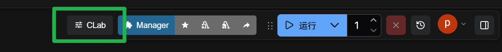
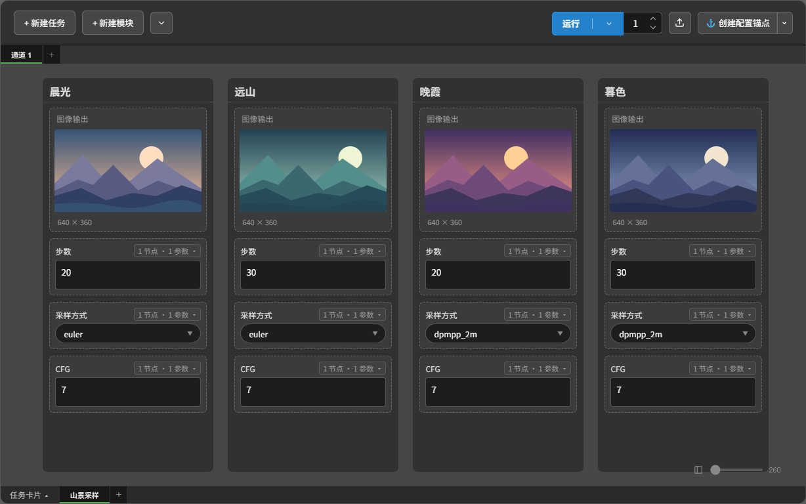
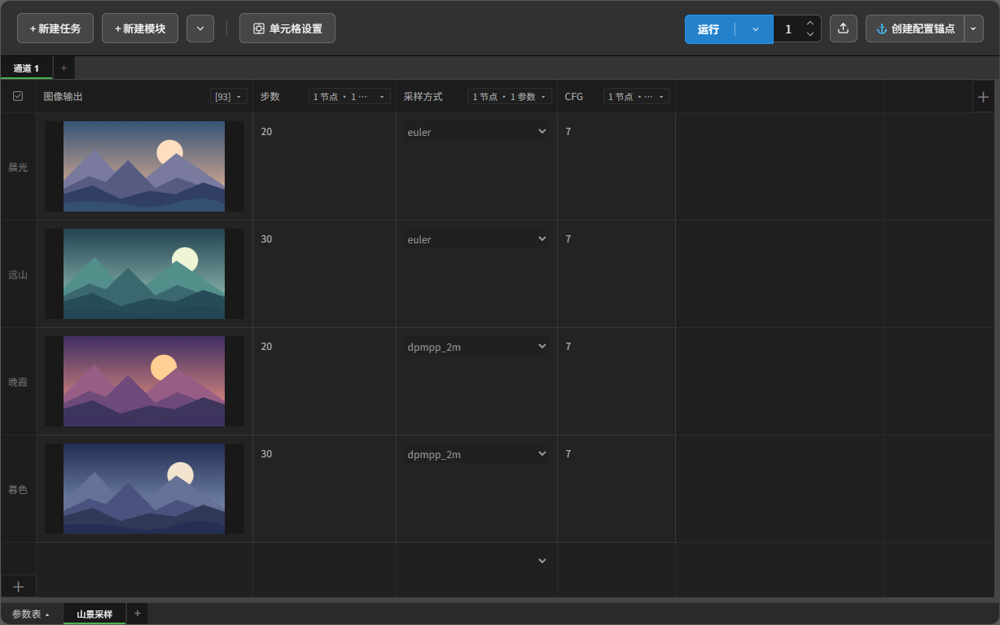
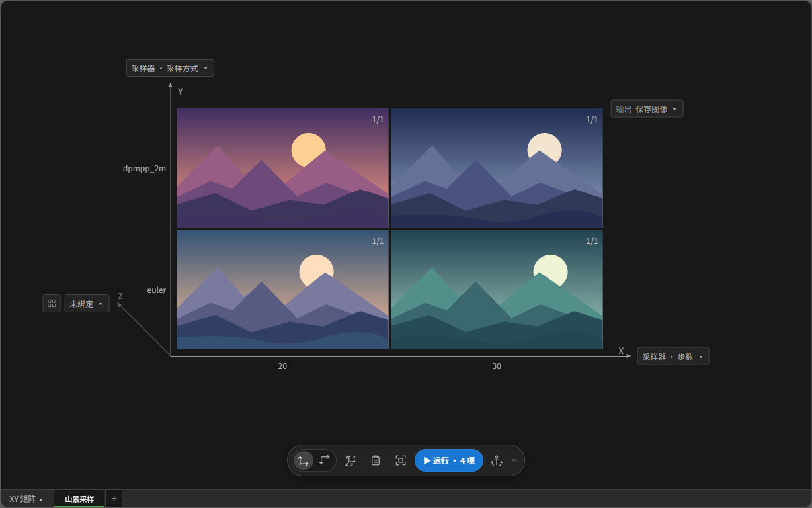

# ComfyUI-CreativeLab (CLab)

CLab (Creative Lab) 是一个为 ComfyUI 打造的任务管理面板。通过任务卡片、参数表和 XY 矩阵，可以在保留工作流连线的情况下，管理任务、批量设置参数和运行参数组合。

https://github.com/user-attachments/assets/535a99a4-1c8a-4c2e-94d2-b4aabb8171ce

---

## 💡 如何打开插件？

- **快捷键**：按下键盘上的 `C` 键（可在设置中自定义）。
- **界面入口**：点击 ComfyUI 顶部主菜单栏右侧的 **CLab** 图标按钮。

    

---
## 🗂️ 工作区

顶部标签栏用于切换工作区。每个工作区独立管理任务、参数值、节点绑定和生成历史。复制工作区后，可以在副本中绑定另一组节点。

常用操作：

1. **新建**。点击标签栏末尾的 `+` 新建工作区。
2. **重命名**：双击标签文字可直接重命名。
3. **右键菜单**：支持新建、复制、重命名、删除。
4. **多选**：`Ctrl/Cmd` 点选多标签，`Shift` 区间多选。
5. **拖拽排序**：支持拖拽重排标签顺序（多选后也可批量移动）。

保存与恢复：

- 首次修改插件数据时自动创建配置锚点。按 `Ctrl+S` 将工作区保存到工作流，重新打开时自动恢复。
- 打开旧工作流时，每个旧通道转换为一个独立工作区，带入该通道的绑定及原任务、参数值和历史。单通道工作区保留原名。

---
## 📐 工作区模式

点击当前工作区名称旁的模式文字，可选择「任务卡片、参数表、XY 矩阵」。其他工作区悬停时显示小三角。默认名称带模式前缀，如「参数表·工作区 1」，手动重命名后使用自定义名称。首次进入参数表或 XY 矩阵后，工作区会保留该结构类型；可往返任务卡片查看、编辑原任务，参数表与 XY 矩阵之间禁止直接或经任务卡片中转互换，不兼容选项置灰。每个工作区分别保存模式、模板、坐标轴及画布视角，返回原模式后无需重新绑定 X/Y/Z 轴。

### 任务卡片

每张卡片独立组织输入、输出和生成历史，适合混合不同结构的任务。阅读[任务卡片说明](web/docs/任务卡片.md)。

### 参数表

每行一个任务，每列一个输入或输出模块。适合统一设置列绑定、批量取值，或从 Excel 粘贴数据。阅读[参数表说明](web/docs/参数表.md)。

### XY 矩阵

在画布上设置 X、Y 轴的参数组合，通过可选的 Z 轴分层，按格子运行并比较生成结果。阅读[XY 矩阵说明](web/docs/XY矩阵.md)。

---

## 📥 导入

https://github.com/user-attachments/assets/12f6ba64-4524-4fd9-959b-0c2c0995b16e

- **从剪切板导入JSON数据**
    - **创建任务：** 将数据作为新卡片追加到末尾。
    - **追加模块：** 追加到现有任务卡片，超出时自动新建。
    - **追加模块到选中：** 严格按 1对1 顺序追加到当前选中的卡片内。
- **从本地文件导入JSON数据**
    - 同上（创建任务 / 追加模块 / 追加模块到选中）。

## 📤 导出

进入预览窗口，在当前模式右侧的参数栏下载、整理或导出数据。左侧来源与显示字段决定处理范围。

- **下载媒体**。选择打包 ZIP 或保存到文件夹，点击下载全部或下载选中。勾选历史选项可扩展记录范围。
- **收集整理**。点击复制到子文件夹，将媒体复制到 ComfyUI 输出目录下的归档子文件夹。
- **导出 JSON 数据**。选择输入模块、输出模块或输入+输出模块，再点击复制或下载。历史选项将输出文件路径扩展为数组。
- **版式导出**。明细表、参数表和 XY 矩阵的右栏提供 PNG、HTML 等对应格式的导出设置。

## ▶️ 运行

https://github.com/user-attachments/assets/293f831d-b290-43e9-8515-6b9aa75a7b85

- **运行：** 根据所选内容执行任务。
    - **未选中任何内容：** 任务卡片运行全部任务，参数表运行全部有效任务行；XY 矩阵运行当前 Z 层的全部任务。
    - **选择“任务卡片”运行：** 注入输入参数，运行该卡片内所有的输出节点。
    - **选择“输入模块”运行：** 等同于选择卡片运行。
    - **选择“输出模块”运行：** 仅执行所选输出及其依赖节点。
- **运行参数快照：**
    - 点击运行时，保存当前卡片中已绑定节点参数的输入模块状态，作为本次任务的参数。
    - 生成成功并拿到文件路径后，才会把该次快照与该条历史记录绑定保存。
    - 如果运行报错、没有产出可保存媒体，或抓取失败，则不会留下这次快照记录。
- **运行期间切换工作区：** 结果和参数快照保存到任务发起时的工作区；运行使用点击时保存的输入参数与绑定。
- **运行全部：** 按顺序运行当前工作区的全部任务卡片。
- **运行次数：** 在运行按钮旁输入次数，按卡片顺序交叉循环。例如，卡片 A、B 运行 3 次，顺序为 `A → B → A → B → A → B`。
- **打断运行：** 三种工作区共用「数量｜运行＋菜单｜打断」控件。插件有待运行任务时，右侧打断按钮变红；点击后停止当前运行，并取消插件各工作区已提交及尚未提交的后续批次。已生成结果与历史保留，结束后按钮恢复灰色。数量设置也适用于 XY 矩阵，按当前运行范围循环。
- **滚动排队：** 三种工作区共用提交窗口，默认按 1 个运行、最多 4 个等待的规模提交，完成后自动补交；可在「性能与媒体播放 → 提前排队任务数」调整为 1～10。尚未提交的任务保留点击运行时的参数快照，不提前生成完整运行请求。
    - 关闭插件面板仍可继续补交；刷新或关闭浏览器页面会丢失尚未提交的队列，不能依靠配置节点恢复。
    - 在 ComfyUI 清空等待队列时，同时停止插件尚未提交的任务；当前正在运行的任务仍可完成并保存结果。

## ⚓ 数据维护与配置锚点

首次编辑时，在 ComfyUI 当前画布视图中心或附近空位自动创建 `CLab_SystemConfig` 节点，已有节点直接复用。配置保存在节点的数据值中，前端文本框只显示简短说明；按 `Ctrl/Cmd＋S` 保存工作流才能在重新载入后恢复。临时组件缓存不写入配置，工作流中的媒体路径也不包含媒体文件本身。

工作区工具栏及预览右上角的「数据维护」打开同一个浮动面板，操作范围明确显示为当前活动工作区。上方提供清理失效记录、重新同步记录；下方管理已归档任务，支持全选、恢复和删除。

删除任务卡片或参数表中的任务行时，有标题、参数值、节点绑定或生成记录的任务进入归档，空白草稿直接移除。恢复时保留模块、绑定、参数值及历史；参数表还会恢复原行位置、行高和单元格样式。删除列或模块属于内容编辑，不会将整条任务归档。

移除 XYZ 取值后，对应任务退出当前任务列表。有结果、运行记录或手动修改的任务进入归档；尚未运行且未修改的自动任务直接清理。再次加入相同参数组合会复用归档中的任务及历史。手动恢复到矩阵时会补回相应轴取值，若连带增加其他组合会提示。删除归档只移除插件中的任务与历史引用，保留磁盘上的媒体文件。

XY 轴换绑同类型参数时保留取值、顺序及输入格式。已有结果或已提交运行的旧任务保留原绑定进入归档，新绑定建立对应任务；恢复原绑定和组合后可复用旧结果。归档任务的绑定与当前矩阵不兼容时，可切换到任务卡片模式恢复。复制工作区保留已完成历史，清除副本继承的排队／运行标记；原运行结果仍写回原工作区。

再次点击「数据维护」入口、点击面板外或右上角关闭按钮可收起。清理失效记录针对文件已不存在的历史；重新同步用于刷新被外部软件修改的媒体，不是重新生成结果。

## 🎛️ 多媒体组件

https://github.com/user-attachments/assets/896f42b5-838b-4f9d-a1cb-6c8999cfb38f

- **视频组件：**
    - **播放 / 暂停：** 单击视频画面；悬停、暂停或操作控件时显示控制条。
    - **调节进度：** 在画面上滚动鼠标滚轮，或点击进度条跳转；时间码显示为 `分:秒:帧 (MM:SS:FF)`。
    - **音量：** 悬停喇叭图标展开滑杆，向左增大、向右减小。静音时拖动滑块可恢复声音；没有音轨时，静音按钮不可用。
    - **播放速度：** 手动输入倍速或从下拉列表选择。
    - **全屏 / 画中画：** 点击对应按钮切换。
- **音频组件：**
    - 匹配媒体比例时使用紧凑波形播放器，也可关闭后手动调整比例与尺寸；支持播放、暂停、调节进度、音量和播放速度。
    - **播放 / 暂停：** 单击波形；下方进度条用于跳转和拖动进度。
    - **滚轮调节进度：** 在波形区域滚动鼠标滚轮，向前或向后调整播放位置；滚动时暂停，结束后恢复之前的播放状态。
    - 波形进入可见区域后按需读取并缓存；波形不可用时仍可播放音频。
- **文本组件：**
    - 支持抓取节点输出文字并自动保存为本地 `txt` 历史记录，可在模块内直接预览。
    - 支持语法高亮和 Markdown 预览；预览区根据文本高度调整，长文本可滚动查看。
    - **复制全文：** 悬停模块后，点击右上角“尺寸与显示”齿轮左侧的复制图标；开启 Markdown 预览时仍复制原文。
- **底部信息：** 图片、视频显示实际分辨率，音频显示格式与时长，普通文件显示格式；历史序号统一在右下角，多条记录时显示。各模块的序号按自身记录计算，关联切换规则不变。
- **通用文件组件：**
    - 对于未提供专用预览的文件格式，显示文件名与“点击下载”链接；支持的文本格式由文本组件预览。
- **3D 模型与动作组件：**
    - **输入预览：** 开启“查看 3D”，在上传区预览模型。
    - **输出预览：** 支持标准 3D 文件列表和旧版预览节点返回；运行后直接在模块内预览；通过右键菜单的“预览模式”打开独立窗口，沿用历史记录、下载与关联切换规则。
    - **静态格式：** GLB / glTF 2.0、FBX、OBJ、STL、普通 PLY 网格与点云；BVH 以骨架显示。
    - **视角操作：** 在 3D 预览区内左键拖动旋转，中键或右键拖动平移，滚轮缩放；预览区外拖动仍用于移动模块。右键单击打开菜单，右键拖动平移时不弹出菜单。“重置视角”恢复初始视角。
    - **动画播放：** GLB / glTF、FBX 和 BVH 中的有效动作片段显示底部控制条，默认暂停。单击模型或播放按钮切换播放 / 暂停；可选择片段和播放速度。
    - **动画进度：** 底部进度条可拖动；`Shift＋滚轮` 前后调节，调节时暂停，结束后恢复原播放状态。暂停时停止逐帧刷新；暂时隐藏插件面板后重新打开，会恢复对应预览的位置、片段、速度和播放状态。
    - **配套资源：** 外置 `.bin`、MTL 和贴图需保持原有相对目录结构。归档时将已找到的配套文件复制到独立模型目录，保留引用关系；缺少贴图会提示，模型仍尽量显示。
    - **支持限制：** 暂不包含 Draco / Meshopt / KTX2 解码、高斯泼溅 PLY 及专用 NPZ 动作数据适配。“保存 GLB”接收已有文件时可能保留原格式，需以实际扩展名为准。
    - **资源管理：** 本地按需加载查看器，静止或暂停时不持续渲染；隐藏时暂停绘制；查看器按缓存上限及约 30 秒期限回收模型、贴图和 WebGL 资源，回收后保留视角与动画状态供再次加载。
- **生成记录管理：**
    - **视频缩略图：** 固定使用静音起始画面、按需预载元数据，不自动循环播放。
    - **多选与批量移除：** 网格中支持 `Ctrl/Cmd` 点选、`Shift` 区间连选；点击已选缩略图右上角的 `✖`，批量移除所选记录。
    - **拖拽排序：** 拖动缩略图可调整历史记录顺序，对应的输入参数快照随记录一起移动。

## 🔎 预览模式

点击工作区工具栏最右侧的「预览」，在顶部中央切换页面；右上角「工作区」返回。任务卡片默认进入浏览，参数表和 XY 矩阵默认进入对应页面。兼容的工作区之间切换时保留当前页面，遇到结构冲突才使用默认落点。

| 模式 | 用途 | 详细说明 |
| --- | --- | --- |
| 浏览 | 逐条查看媒体及运行参数，管理封面、浏览和排序历史 | [浏览说明](web/docs/预览模式.md#浏览) |
| 比较 | 跨任务、模块或工作区选择两张图片／两个视频，并排或分屏比较 | [比较说明](web/docs/预览模式.md#比较) |
| 明细表 | 将任务的内容、独立封面和输入字段排成卡片，调整样式并导出 | [明细表说明](web/docs/预览模式.md#明细表) |
| 参数表 | 沿用任务行与模块列，筛选字段、调整单元格并导出 PNG、Excel、HTML | [参数表预览说明](web/docs/预览模式.md#参数表) |
| XY 矩阵 | 筛选轴取值、切换或平铺 Z 层，调整坐标轴与矩阵排布后导出 | [XY 矩阵预览说明](web/docs/预览模式.md#xy-矩阵) |

通过「增加预览来源」或标签栏多选，可同时整理多个工作区。五个模式的右栏共用媒体下载、收集整理和 JSON 导出；排版、历史、保存与快捷键的完整规则见 [预览模式详细说明](web/docs/预览模式.md)。参数表与 XY 矩阵仍遵循工作区结构兼容限制。

## 撤销与重做

- **插件内容编辑**。面板打开且未编辑文字时，`Ctrl/Cmd+Z` 撤销，`Ctrl/Cmd+Shift+Z` 或 `Ctrl/Cmd+Y` 重做，支持任务结构、参数取值、绑定和表格／矩阵设置。
- **按工作区隔离**。不同工作区分别保留撤销和重做记录，互不清空。同一工作区的三种工作区视图及预览界面共用记录，可在预览中撤销工作区的编辑，也可返回工作区撤销预览参数表的列名、尺寸等修改。明细表的布局、字段样式、封面和内容模块设置也可撤销。
- **按可见性定位**。当前页面能展示结果时原地撤销，不因操作来源不同而切换界面。看不到结果时，自动切换到相应的工作区／预览页面并定位任务或字段。例如工作区参数表可以直接撤销预览中的列名修改；工作区看不到明细表字号变化时，自动打开明细表。重做遵循相同规则，切换本身不计入历史，一次按键仅处理一步，不转换工作区结构。
- **到达记录边界**。没有更多步骤时继续按撤销或重做不执行操作，不会继续使用 ComfyUI 的工作流历史，也不会因此删除或切换工作区。
- **查看操作**。来源筛选、搜索、选择、滚动、缩放、平移及历史记录浏览不增加内容撤销步骤。历史浏览自动回填的参数同样不作为新编辑；尽量保留当前查看状态，定位对象被筛选隐藏时会显示对应对象。
- **多工作区预览**。最近点击的工作区表格、矩阵或任务决定撤销对象；未指定时使用活动工作区。批量修改多个工作区时，各自记录该次修改，在其中一个工作区撤销只影响自身。
- **文本编辑**。在可编辑输入框中继续使用原生文字撤销；结束编辑后可撤销插件操作。参数表仅选格、未进入文字编辑时使用插件撤销。
- **生成结果**。撤销参数编辑不会回退后来生成的历史；撤销删除可以找回完整任务。撤销或重做使任务退出当前列表时，已有结果或已提交运行的任务进入归档；重做恢复时复用原任务和历史。运行本身不会因撤销而取消。
- **记录范围**。撤销记录仅保存在当前浏览器会话中，每个工作区最多约 100 次操作，并分别限制记录体积；刷新页面或载入工作流后重新开始。新建工作区从空记录开始，删除工作区同时释放其撤销记录。关闭插件后，工作流仍使用 ComfyUI 自身的撤销。

## 📁 资产管理

- **自动归档：** 将输出文件复制并重命名到 `output/CLab` 文件夹，归档目录和文件名前缀可在设置中修改。
- **恢复数据：** 加载工作流时，从配置锚点恢复面板数据，并加载对应的媒体文件。

## 👁️ 界面适配

- **工作区工具栏**。三个模式默认停靠在顶部。拖动工具栏空白处可横向悬浮，或吸附到顶部、底部。切换模式或工作区时沿用同一位置。任务卡片和参数表的选中项工具在停靠时居中，悬浮时独立显示。右键点击工作区栏空白处，可选择「在上方」或「在下方」。

## ⚙️ 核心偏好设置 (Settings)

点击 ComfyUI 设置齿轮（Settings），在 **`Creative Lab`** 分组中调整以下选项：

### 1. 常规 (General)

工作区与预览面板共用宽度、高度、背景不透明度和毛玻璃设置，修改后同时生效。

- **新建工作区的默认模式**可选任务卡片、参数表或 XY 矩阵。
- **恢复全部默认设置**：一键将面板内的所有 CLab 选项重置为出厂状态。
- **快捷键**：自定义呼出/隐藏面板的组合键（支持单字母或 `Shift+C` 等组合键）。
- **节点拾取快捷键**：默认为 `P`，支持自定义组合键，留空可禁用。
- **启用背景毛玻璃效果**：开启或关闭面板背景模糊。
- **面板背景不透明度**：在 0%~100% 之间调整。
- **面板宽度 / 高度比例**：分别设置面板相对浏览器窗口的宽、高比例，默认均为 92%，可在 40%~100% 之间调整。

### 2. 性能与媒体播放 (Performance & Media)

- **历史记录容量上限**：设置单个输出模块最多保存的记录数，超出后移除最旧记录及对应的输入参数快照。
- **切换历史时同步参数 (Sync Parameters on History Switch)**：默认开启，切换输出历史时回填该条记录的输入参数；关闭后仅切换输出预览。
- **提前排队任务数**：默认 4，可设为 1～10；按一个运行任务加指定等待数量的规模滚动补交。
- **缓存数量**：最近卡片、普通组件、音视频、3D 默认分别为 8、64、2、1，0 表示关闭对应缓存；只影响浏览器资源复用，不删除任务或历史。隐藏音视频和 3D 还会在约 30 秒后释放资源。
- **视频默认静音**：设定新加载主视频的初始静音状态，保留已有播放器的手动选择；比较模式独立选择 A/B 声音，缩略图固定静音。视频首次加载不自动播放，历史缩略图固定显示静帧。

### 3. 文件与数据流转 (File & Data I/O)

- **归档文件夹名称**：设置自动归档和整理文件的根目录，默认为 `CLab`。
- **是否保留原临时文件**：关闭后，归档完成时删除原临时文件。
- **生成文件名前缀**：设置归档文件的名前缀，默认为 `pix`。

### 4. 自动化行为 (Automation)

- **连续运行异常阻断**：默认开启，任务校验或运行报错时停止本次批次的后续任务，并取消该批次已提交的后续排队项。关闭后跳过出错任务继续执行；其他批次和 ComfyUI 原生队列中的无关任务保持原有状态。

### 5. 任务卡片选中态外观 (Card Appearance)

- 可自定义卡片选中时的发光、填充、描边与高亮色。默认：**描边 1 px、填充透明度 0%、发光强度 10、高亮色 #4CAF50**。

### 6. 模块选中态外观 (Module Appearance)

- 独立自定义模块（输入/输出区）被点击选中时的反馈效果，包含：**发光强度**、**填充透明度 (%)**、**描边粗细 (px)** 以及 **高亮主题色**（默认亮蓝）。

### 7. 任务卡片

- 卡片间距、模块间距和卡片内边距即时生效。默认卡片宽度用于首次打开和点击「恢复默认宽度」。视图两侧的加载缓冲默认各约 5 张，可在设置中调整。

### 8. 参数表

- 设置新工作区的默认列宽、行高和单元格内边距。

### 9. XY 矩阵

- 设置新工作区的默认 Y 轴方向、格子间距及坐标轴到格子的距离。

---

## 📖 更新与维护

- [📅 更新日志](web/docs/更新日志.md)

- [🔎 预览模式详细说明](web/docs/预览模式.md)

- [📘 开发指南](web/docs/开发指南.md)

- [🗺️ 开发者功能映射手册](web/docs/开发者功能映射手册.md)

- [🛡️ 多选护盾与高级拖拽](web/docs/多选护盾与高级拖拽.md)

- [🔢 运行次数与批处理机制](web/docs/运行次数与批处理机制.md)

- [📦 资产管理与状态同步原理](web/docs/资产管理与状态同步原理.md)

- [🗂️ 工作区标签栏与旧通道迁移](web/docs/工作区标签栏与通道标签栏开发文档.md)

- [🔧 局部微创更新重构记录](web/docs/局部微创更新重构记录.md)

## 🤙 联系方式

如有问题请提交 Issue。

- bilibili：[噼哩画啦](https://space.bilibili.com/1370099549)

- 邮箱：pixixai@gmail.com
  
- 邮箱：pixixai@qq.com
