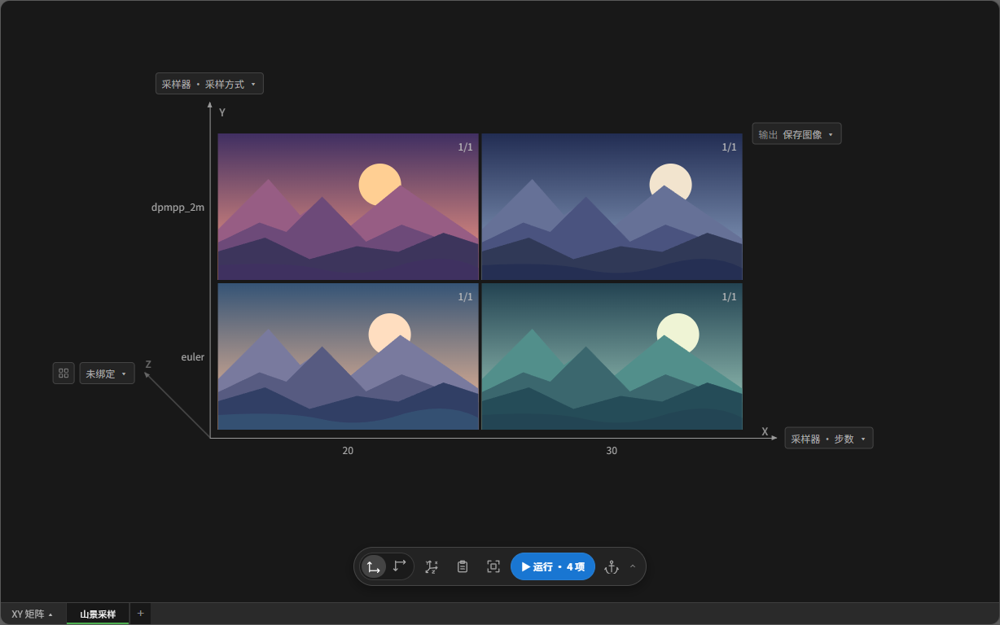

# XY 矩阵

点击当前工作区名称旁的模式文字，选择「XY 矩阵」。在画布上绑定坐标轴并设置取值，CLab 会按参数组合建立任务。点击工具栏最右侧的「预览」，可调整当前矩阵的展示和导出选项，也可按历史参数重排。详见 [README 中的预览说明](../../README.md#预览窗口的-xy-矩阵)。

工作区会保留 XY 矩阵结构类型，可切换到任务卡片并返回矩阵，不能转为参数表。打开预览的默认落点是 XY 矩阵；兼容工作区之间切换时保留当前预览模式，仅遇到类型冲突时使用默认落点。参数表入口置灰；浏览、比较、明细表仍可使用。

## 创建与运行矩阵

1. 直接切换到 XY 矩阵，无需先建立任务卡片。点击两轴箭头旁的绑定摘要，分别绑定节点参数。面板左侧选择节点、右侧勾选参数。同一轴可绑定多个参数。
2. 点击坐标轴或刻度打开“X轴设置 / Y轴设置”，调整间距、边距并编辑取值，如 `20,30,40` 或 `[20,30,40]`。多参数按勾选顺序填写组合，例如宽、高对应 `[[512,768],[768,1024]]`。组内一一对应，两轴交叉组合，相同组合值合并。选项勾选后立即应用，文本结束编辑后自动应用，也可按 `Ctrl/Cmd＋Enter`。无效输入保留原矩阵并提示。
3. 点击矩阵右侧的“输出”摘要，统一绑定矩阵的输出节点。每组 X/Y 组合只显示一格，已有组合直接复用。同一组合有多张任务时，优先显示已有结果的任务，其余任务及历史保留在卡片视图。移出当前取值范围的任务退出当前任务列表；已有结果、运行记录或手动修改的任务进入当前工作区的归档，未运行且未修改的自动任务清理。
4. 单击单元格选择，`Ctrl/Cmd` 加选或取消，`Shift` 按两点间的矩形范围连选。未选中时，通过底部蓝色按钮运行矩阵，启用 Z 时默认运行当前层。选中后仅运行所选单元格。也可右键空白处选择运行范围，矩阵外任务不会混入。

矩阵与卡片视图共用输出抓取及预览组件，支持已适配节点的图片、视频、音频、3D 与文本输出。每格展示统一绑定的一个输出节点，并独立保存其历史。

各绑定面板右上角均有“拾取节点”。点击后插件面板隐藏，拾取完成后返回原绑定面板。点击参数可直接绑定，点击节点本体后可在面板中继续选择参数。轴参数支持左键替换、右键追加。输出及单条附加记录保持单选。

矩阵上方的 Z 层标题与每层矩阵等宽、居中，长文本自动换行并向上展开，底部与绑定摘要保留间隙。工作区与预览使用相同规则。

预览左侧勾选的附加记录参数随工作区保存，在 Z 轴摘要旁的半透明记录表集中显示，按节点名称、参数名称、参数值分三列，不覆盖媒体；默认长名称省略、参数值最多显示两行，悬停查看完整内容。左侧“显示全部内容”随工作区保存，开启后列宽有上限、内容完整换行，原始记录不截断。Y 轴向上时，记录表默认与 Y 轴摘要顶对齐，底部靠近 Z 轴摘要时整体上移；Y 轴向下时，默认与 Y 轴摘要底对齐，顶部靠近 Z 轴摘要时整体下移，两种情况均保留间隙。

工作区和预览共用当前工作区的缩放、平移位置；切换 Z 层或平铺不会重置预览视图，需要重新居中时点击“适配视图”。

左键单击格子选择，拖动格子、坐标轴或空白处平移画布；中键拖动同样平移，滚轮以鼠标位置为中心缩放。工作区与预览使用相同规则，均支持 `Ctrl/Cmd` 加选和 `Shift` 矩形连选。媒体内部的播放控件及 3D 旋转保持原操作，`Ctrl＋滚轮` 可缩放矩阵。

## 绑定与取值

- **绑定摘要**。显示节点名称和参数名称，沿用 ComfyUI 当前语言的显示名称，随文字自动加长。内部仍按节点 ID 与参数标识保存。失效绑定保留并提示，不会自动换成其他参数。X/Y 轴同时绑定同一参数时会提示调整。
- **取值面板**。在所点击坐标轴的外侧展开，X 轴根据方向显示在上方或下方，Y 轴显示在左侧。靠近屏幕边缘时自动约束大小并滚动。布尔值和下拉参数列出全部选项，点击名称或复选框添加、移除值。多参数组合仍可编辑数组，勾选选项新增组合时，其余参数沿用最后一组。
- **轴取值**。文本和数字统一使用一个批量输入框，不设置显示名称或编号。固定选项、布尔值保持勾选列表。
  - **设置取值 / 取值排序**。面板默认打开“设置取值”。“取值排序 · 数量”实时显示有效草稿解析出的取值数量。切换到排序页时应用输入。输入格式错误时保留原矩阵和草稿，并停留在输入页。固定选项始终保留完整列表及勾选状态，上方从左到右为“全选、已选择 N 项、取消选择”。全选补齐所有当前有效选项并保留已选顺序，取消选择移除当前选项取值。排序页仅显示已选取值。每条右侧的 `×` 移除该取值并同步输入框。固定选项、布尔值同时取消勾选，之后仍可重新添加。移除取值会将已有结果或手动修改的任务归档，保留其生成历史；再次加入同一组合时恢复。
  - **方向与对齐**。在“轴取值”标题下，使用九宫格选择文本的对齐点，拖动角度圆盘或输入 `0～360°` 实时旋转。`0°` 水平向右，正角度顺时针。选定的文本锚点始终对齐原刻度分布点，角度改变时刻度位置不动。默认 X 轴在 Y 向上时使用上中点、Y 向下时使用下中点。Y/Z 均使用右中点。手动选择后保留该轴的对齐设置，三轴各自保存，不影响参数值、任务及历史。
  - **拖拽排序**。在排序页拖动左侧把手，会提起半透明选项，其他项平滑让位。松开后将取值插入目标接缝。到列表边缘时自动滚动，松开后同步回输入框和矩阵。多参数组合整组移动，已有结果、历史与参数快照保留在对应组合上，Z 当前层按实际取值保持。拖拽回写尽量保留逗号、换行或 JSON 格式。长内容省略显示，悬停查看全文。
  - **文本**。每个非空行作为一个值，保留行内逗号。也支持 JSON 数组，例如 `["森林, 小屋","城市, 雨夜"]`。单条文本内需要换行时，使用 JSON 字符串中的 `\n`。已有多行取值会以 JSON 显示，避免被意外拆分。
  - **数字**。支持逗号、换行及 JSON 数组，逗号和换行可混用，例如 `20,30` 后换行填写 `40,50`。关闭、重开面板及保存工作流后保留原输入格式，不自动改为每行一个值。
  - **多参数组合**。仍按绑定顺序填写 JSON 二维数组，例如 `[[512,768],[768,1024]]`。也可每行填写一组逗号分隔值。组合中包含逗号或换行的文本时，使用 JSON。
  - **刻度显示**。直接显示实际内容，组合值以 `×` 连接。内容过长时省略并显示 `…`，悬停查看完整内容。X 刻度限制在对应列内，Y 刻度在左侧右对齐。点击 X/Y 刻度打开取值输入框，点击 Z 刻度切换层。省略仅影响外观，运行、参数快照及视图转换使用完整原值。

## Z 轴分层

- **Z 轴分层**。从 XY 交点向左上方延伸的短轴，未绑定时为灰色，绑定参数后自动建立分层。点击轴线或字母 Z 打开取值设置，箭头旁的绑定摘要打开绑定面板。支持多个参数的成组取值。同一个参数不能同时由多个已绑定的坐标轴控制。
  - **建立分层**。绑定 Z 时保留任务已有的该参数值，尚未设置的任务带入工作流当前值。继续添加 Z 取值后，自动建立各层的参数组合任务。例如 X 有 3 个值、Y 有 2 个值、Z 有 4 个值，共 24 项任务。
  - **查看分层**。单击 Z 刻度切换对应的 XY 图，保留画布视角，并清空原选择。取值较多时点击 `…` 展开完整切层列表。工具栏的“平铺所有 Z 层”切换单层／平铺，启用后才显示旁边的设置齿轮，独立打开列数及行列间距菜单；行间距和列间距并排显示，列数留空时自动排列。预览右侧“矩阵显示”勾选平铺后，在复选框下方直接展开相同设置，取消勾选时收起；状态和布局设置按工作区同步保存。平铺时隐藏 Z 轴线、字母和取值，将唯一的 Z 轴绑定摘要放在整组矩阵上方的公共标题区左侧，保留各层 XY 坐标及 Z 值标题；单层模式恢复原摘要位置。预览平铺设置区上下留出间距，并用低对比度细线分隔。再次点击菜单入口可关闭菜单。
  - **媒体加载**。尚未显示的层暂不加载媒体，第一次切换过去时再加载。隐藏层的新结果仍完整保存，显示时再更新。已加载的图片与播放器优先复用，隐藏时暂停音视频和 3D 绘制。隐藏的 3D 查看器最多缓存 3 个，超出时释放资源并保留视角、动画状态，返回时恢复。
  - **运行范围**。工具栏的蓝色运行按钮默认运行当前层，选中当前层的格子后仅运行这些格子。打开右侧菜单可选择“运行全部”，该操作不受局部选择影响，也不会改变主按钮的默认行为。平铺时仍默认运行当前层，Ctrl/Cmd 可跨层加选，Shift 在同一层内按矩形范围连选。
  - **历史与转换**。每个 XYZ 组合独立保存全部生成历史，切换 Z 层不会切换或覆盖该格历史。往返任务卡片时继续使用原任务、Z 参数绑定和历史；不支持转换为参数表。

## 画布与工具栏

- **画布**。不显示顶部工具栏。空白处左键拖动平移。按住空格后，无需按鼠标左键，移动鼠标即可平移，松开空格停止。也可按住中键拖动。空格和中键抓手均可跨越坐标轴、刻度及格子，编辑输入框时不触发空格抓手，失去焦点或离开矩阵模式时退出。点击坐标轴、绑定入口或工具栏后，空格仍优先进入抓手，不会再次触发刚才的按钮。设置面板与输入框内继续正常编辑。滚轮朝指针缩放，在媒体上可用 `Ctrl＋滚轮` 缩放画布。
- **矩阵工具栏**。与任务卡片、参数表共用位置，默认停靠顶部。拖动空白处可悬浮或停靠在顶部、底部。左侧为恢复视角；中间依次为轴方向、轴优先、交换 XYZ 轴参数、附加记录参数、平铺所有 Z 层。平铺开关以图标、文字和启用后出现的设置齿轮组成一组。右侧与其他工作区模式共用运行、数据维护和工作区／预览切换。
  - **坐标轴类型**。打开选项框可选择“Y 轴向上”或“Y 轴向下”，选项框显示当前方向。X 轴始终向右，默认 Y 向上。
  - **交换轴参数**。左侧固定显示 X、Y、Z，右侧显示当前绑定参数。拖动左侧把手提起半透明选项，目标参数行平滑换位预览，松开后直接互换这两轴的绑定、完整取值与输入格式，包括多参数组合，其余轴不移动。间距与边距仍属于原坐标方向。已有任务、媒体与历史保留。
  - **恢复视角**。适配当前矩阵，并为底部工具栏留出空间。
  - **运行**。默认显示“运行 · 数量”，未启用 Z 时运行矩阵任务，启用 Z 时运行当前层。选中格子后显示“运行选中 · 数量”并运行选中项。
  - **运行方向**。在坐标轴方向右侧的选项框选择「X 轴优先」或「Y 轴优先」。X 优先沿 X 轴跑完一行再换行，Y 优先沿 Y 轴跑完一列再换列。该设置随工作区保存，也适用于运行选中格子和全部 Z 层。运行全部 Z 层时，按 Z 轴取值顺序逐层运行。
  - **数据维护**。打开统一维护面板，提供「清理失效记录」「重新同步记录」及当前工作区归档任务的恢复、删除。首次修改插件数据时会自动创建配置锚点，按 `Ctrl+S` 保存工作流。
- **轴间距与边距**。X轴间距控制列间距，X轴边距控制 Y 轴到图像的距离。Y轴间距控制行间距，Y轴边距控制 X 轴到图像的距离。每个轴设置面板中，左侧为间距，默认 4。右侧为边距，默认 10，单位随画布缩放。面板始终限制在插件范围内，靠近边缘时自动向内偏移。

## 媒体与历史

- **矩阵显示**。悬停时边缘提亮，选中后显示 1px 蓝色描边。实际运行中的格子使用与进度条相同的进度信号，以彩虹描边沿格子推进一圈，进度不变时保持位置，完成、报错或中断后清除。单击空白处取消选择。网格内不显示参数标注或占位文字，右上角直接显示当前记录与总数，如 `3/5`。多次运行追加到对应输出模块的历史，选中后用 `← / →` 切换。多选时各自前后切换一条。
- **画面比例**。生成前默认 1:1。媒体加载后，按当前各单元格的真实宽高比排序，取中位图像的比例统一显示。偶数个比例取中间偏小的一项，保持使用真实图像的比例。例如完整九种横竖比例取 1:1，仅五种横向比例取 3:2。画布缩放和占位框比例不改写生成尺寸。生成宽高需要通过轴参数组合等输入模块绑定。

## 附加记录与模式转换

- **附加记录参数**。点击底部工具栏的独立记录图标，向上打开记录面板。点击 `＋ 添加记录参数` 自动打开绑定面板，每项绑定一个参数。XY 运行时只读取工作流实际值，不额外注入。记录随当次历史保存，暂不在图像网格中标注。
- **视图转换**。每个单元格对应一张普通任务卡片，输出模块置于最前，继续保留同一模块的全部历史和当前记录，下方保留轴输入与附加记录输入。记录输入初值来自工作流。返回 XY 后恢复原轴绑定、取值、间距、边距、方向、视角及已有历史。由卡片首次进入 XY 时，可从当前任务的输入和输出建立初始轴与绑定。

## 多工作区预览

预览右上角「增加预览来源」可加入其他工作区。各工作区在点状画布中以纯色矩形分组，工作区名称位于各组左上角，平铺 Z 层时在名称旁显示 Z 轴摘要，两者随画布缩放。左侧按工作区折叠筛选；选中格子后，来源栏顶部显示唯一的“当前格子”。多来源总览视角与单工作区视角分开，导出包含当前可见的各组矩阵。

- **选中矩阵：** 单击层标题或矩阵内的格子，标题变蓝；点击层标题保留平铺状态。
- **选中工作区：** 单击画布上的工作区名称，选中其全部矩阵。
- **取消选择：** 单击画布空白处。
- **参数范围：** 右侧参数作用于选中的矩阵；未选中矩阵或工作区时，作用于所有来源工作区的全部矩阵。
- **预设平铺：** 没有 Z 层时也可勾选“平铺所有 Z 层”，以后添加 Z 值时自动使用平铺；未选中时可统一设置所有来源工作区。

[返回 README](../../README.md)
