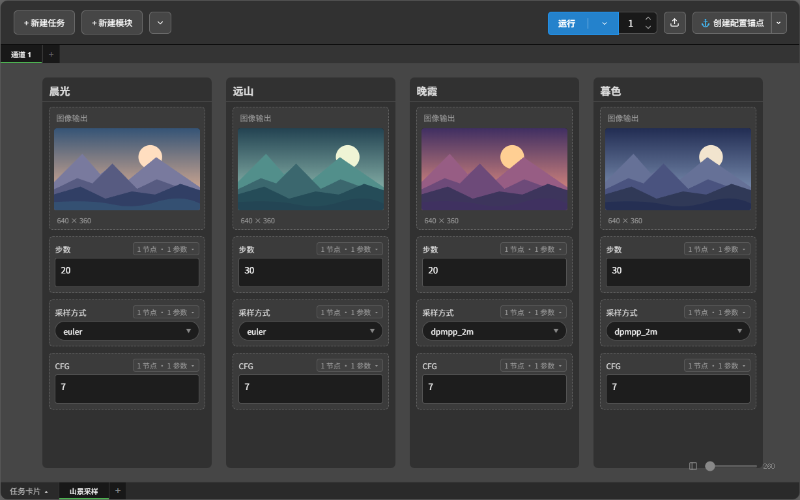

# 任务卡片

点击当前工作区名称旁的模式文字，选择「任务卡片」。每张卡片独立管理参数、绑定和生成历史，适合同时处理结构不同的任务。

删除有内容的任务卡片后，可通过「数据维护」中的归档恢复，参数、绑定和生成历史保留；空白草稿直接移除。未编辑文字时，`Ctrl/Cmd+Z` 撤销内容操作，`Ctrl/Cmd+Shift+Z` 或 `Ctrl/Cmd+Y` 重做，生成历史不会随参数撤销而回退。详见 [撤销与重做](../../README.md#撤销与重做)。

## 任务与卡片

https://github.com/user-attachments/assets/95d58bab-34d8-4d13-a61b-6de866037679

### 新建任务

- **未选中内容**。在任务列表末尾添加卡片。
- **选中卡片或模块**。在对应卡片后添加新卡片，并自动选中新卡片。

### 选择、移动与删除

- **选择**。单击选择卡片，`Ctrl/Cmd` 点选可加选。
- **移动**。拖拽调整顺序，放到目标卡片左半边时插到前面，右半边时插到后面。支持多选批量移动。
- **拖拽克隆**。拖拽时按住 `Alt`，松开鼠标后创建副本，保留模块、绑定、参数值和生成记录，并选中新卡片。
- **删除**。悬停后点击右上角的 `✖`。多选时可批量删除。

### 滚动浏览

- **连续滚动**。按滚轮距离平滑横向移动，不再按整张卡片跳转，也不逐渐加速。触控板同样保持连续位移；精确跳转任务可使用下方刻度尺。
- **区域锁定**。一段连续滚动始终操作开始时的区域，指针滑入卡片内部不会突然改为内部滚动。停下后再在卡片内滚动，可浏览内部内容；视频、音频和 3D 的滚轮操作保留。
- **按需加载**。工作区只显示当前视图及左右缓冲区内的卡片，远处卡片移出列表；最近实际访问过的卡片可按缓存上限暂存，参数、绑定和历史始终保留。可在设置 → 任务卡片 →「左右各侧缓冲卡片数量」调整，默认左右各 5 张。正在编辑、上传或拖拽的卡片暂时保留。跨屏 Shift 矩阵连选和批量操作按完整任务数据执行，不受加载范围限制。

卡片下方的横向刻度尺用于定位任务，最多占工作区宽度的三分之二。近距离采用连续平滑滚动；远距离先从当前位置滚动一小段，跳过中间任务，再从目标附近滚动至目标。两端动画各自不超过约四分之三张卡片，与缓冲卡片数量分开控制。动画期间只准备目标轻量外框并预取少量目标图片，抵达后再分批激活模块，避免布局计算挤占动画时间。再次点击刻度、使用滚轮或在卡片区按下鼠标，可中断原定位。悬停显示标题及可用的图片预览。当前视图位置对应的刻度高亮，悬停刻度及相邻刻度形成波形；任务较多时可在刻度尺上滚轮浏览。定位不改变任务或模块选择。

打开插件时先显示面板，再逐步补齐当前视图的模块及附近缓冲区域；再次打开优先复用已有界面，保留输入焦点、滚动位置和媒体状态。首次读取的媒体可能稍后显示。关闭面板或切换工作区会取消过期的加载批次。

设置 → 性能与媒体播放可分别设置最近卡片、普通组件、音视频播放器和 3D 查看器的缓存数量，默认分别为 8、64、2、1，设为 0 可关闭对应缓存。缓存只存在于浏览器内存中，降低上限会清理超额缓存，不删除任务或生成记录。隐藏的音视频播放器和 3D 渲染资源还会在约 30 秒后释放，之后重新查看时恢复已保存的播放状态或视角。文本高度按内容、宽度和字体等条件复用，内容或相关布局条件改变后重新测量。

运行时，视图自动跟随当前执行的任务卡片，不改变选择。缓冲区提前排好模块布局并测量自动高度文本；播放器在接近视图时才初始化，重新加载使用与卡片宽度、内容匹配的高度缓存。

未选中卡片或模块时，点击「运行」默认运行全部任务；选中输入模块或卡片时运行对应任务，选中输出模块时仅运行对应输出。右侧红色「打断运行」按钮停止当前及插件各工作区的后续批次，保留已经生成的记录。

### 标题与进度

- **标题**。默认为 `#1`、`#2`、`#3`，可点击修改。新建、删除和排序后，默认序号自动更新。
- **进度**。运行后在标题下方显示彩虹色进度条，长度跟随实际进度；报错时变红并显示提示。
- **异常阻断**。开启后停止本次批次的后续任务。关闭后跳过出错任务继续运行。

### 任务卡片工具栏

- **克隆**。复制所选卡片的模块、设置、参数值和生成记录，副本插在所选卡片之后。支持批量克隆。
- **格式刷**。复制卡片的模块结构、设置和绑定，生成记录不随格式刷复制。
    - **点击空白处**。创建卡片，并带入源卡片的参数值。
    - **点击已有卡片**。覆盖结构和绑定，保留目标已有的参数值。补充的新模块使用源参数值。（覆盖功能待完善）

## 模块

https://github.com/user-attachments/assets/f662718d-4038-4678-b940-f737c8bb4d5b

### 新建模块

- **选中卡片**。在卡片末尾添加模块。支持多选卡片批量添加。
- **选中模块**。在每个所选模块下方添加新模块。支持跨卡片批量添加。

### 选择、移动与删除

- **选择**。单击模块选中，包括点击输入框。`Ctrl/Cmd` 点选可加选。
- **矩阵连选**。按住 `Shift` 跨卡片连选相同类型的模块。例如，从卡片 1 的模块 2 连选到卡片 4 的模块 4，会选中这些卡片中第 2～4 个位置上与起始模块类型相同的模块。
- **卡片内移动**。拖拽调整模块顺序。跨卡片多选后，在原卡片内移动其中一个模块，其他所选模块在各自卡片内同步移动。
- **跨卡片移动**。将所选模块拖入另一张卡片，集中插入到目标位置。
- **拖拽克隆**。拖拽时按住 `Alt` 创建副本，保留参数、绑定和生成记录，并选中新模块。
- **删除**。悬停后点击右上角的 `✖`。多选时可批量删除。

### 模块类型

通过工具栏切换输入或输出模块。

**工具栏**

- **克隆**。复制所选模块的设置、参数、绑定和生成记录。
- **格式刷**。复制模块设置和绑定，覆盖已有模块时保留目标参数值。
- **重置**。清除所选同类型模块的节点和参数绑定，恢复默认显示设置，保留输入值和生成记录。
- **同步参数**。将当前模块的绑定和显示设置同步到标题、类型相同的模块，保留目标各自的输入值与生成记录。未命名模块按同类型默认序号（如 `##1`）匹配。
- **输入模块专属**
    - **参数框高度适配**。文本框根据内容自动撑开。图片、视频上传区按媒体比例显示。
- **输出模块专属**
    - **管理生成记录**。打开历史记录网格，选择、排序或移除记录。

**输入模块**

- **标题**。默认为 `##1`、`##2`，可点击修改。
- **绑定摘要**。左键点击摘要，打开绑定面板。
    - 显示“节点数 · 参数数”或“未绑定”，悬停查看完整信息。
    - **绑定设置面板**
        - 支持绑定多个节点的不同参数，模块值会应用到这些参数。
        - 点击节点行，查看并高亮对应的参数分组。
        - 勾选或取消勾选复选框，绑定或解绑节点、参数。
        - **[拾取节点](#拾取模式)**。点击进入拾取节点模式。
- **参数值**。在运行时传递给绑定参数。（注：在绑定后，各模块已有的手动输入值分别保留。）
- **媒体文件上传**。绑定支持上传的参数后，显示上传区。
    - **支持类型**。图片、视频、音频、3D 模型或通用文件。
    - **拖拽上传**。将文件拖入上传区。
    - **按钮上传**。点击上传按钮，选择文件。
    - **粘贴上传**。选中模块后粘贴剪贴板中的文件。
    - **已有文件**。节点提供文件列表时，可从中选择。
- **媒体预览与清除**
    - **预览开关**。标题旁的“查看图片 / 视频 / 音频 / 3D”默认关闭，开启后才加载预览。按模块保存开关状态。
    - **收起预览**。仅保留文件选项框、上传和清除按钮。仍可拖拽或粘贴上传。关闭预览会停止播放并释放预览资源。
    - **清除**。清除模块当前的文件选择。

**输出模块**

鼠标悬停模块后，可通过右上角的齿轮调整尺寸，或点击绑定摘要管理节点。

- **标题**。默认为 `##1`、`##2`，可点击修改。
- **绑定摘要**。左键点击摘要，打开绑定面板。
    - 显示 `[节点编号]` 或“未绑定”，悬停查看节点名称。
    - **绑定设置面板**
        - 仅可绑定一个节点。
        - 节点列表保持原有顺序，打开面板时定位到当前绑定节点。
        - 点击其他节点切换绑定，再次点击已选节点取消绑定。
        - **[拾取节点](#拾取模式)**。点击进入拾取节点模式。
- **尺寸与显示**
    - **显示方式**
        - **显示全部**。完整显示媒体，比例不一致时留白。
        - **填充**。填满预览区，超出部分裁切。
        - **拉伸**。按预览区比例拉伸媒体。
    - **匹配媒体比例**。使用媒体真实宽高比，并自动切换到自定义比例。
- **切换历史记录**。单独选中一个输出模块，且当前未编辑输入框或文本时可使用快捷键。右键“预览模式”窗口采用相同规则。
    - **`←` / `→`**。关联切换，同一卡片中共同参与该次运行的输出模块一起显示对应结果。
    - **`Shift + ←` / `Shift + →`**。仅切换当前输出模块，其他输出模块保持当前显示。
    - **点击历史缩略图**。默认关联切换。生成记录管理中的 `Ctrl/Cmd` 点选、`Shift` 范围选择仍用于选择记录。
- **历史关联规则**。按每次运行的唯一编号关联，支持图片、视频、音频、文本和 3D 文件，不依赖各模块的历史序号或条数。
    - **单独或部分运行**。只关联该次运行实际参与的输出模块，未参与的模块保持原样。其他卡片不受影响。
    - **一次输出多张图**。其他模块已显示该轮时保留当前图片，否则显示该轮第一条记录。
    - **缺失结果**。参与了该次运行但没有对应结果，或记录已被移除时，显示“该次运行无可用记录”，保留其余历史。
    - **旧记录**。没有运行关联信息的旧记录仍可独立浏览。新生成的记录支持关联切换，删除、排序和保存工作流后保留对应关系。
- **历史参数回填**。默认开启，切换记录时恢复对应的输入模块标题、参数值和绑定。缺失模块自动补齐，保留当前多出的模块。可在设置中关闭。没有参数快照的旧记录只切换预览。
    - 关联切换与仅切换当前模块均遵循此设置。回填使用当前主动查看记录的参数快照。

### 拾取模式

可使用以下三种方式进入拾取模式：

- **鼠标中键**。在模块任意位置单击中键（按下滚轮）。
- **键盘快捷键**。按 `P` 进入拾取模式。
    - **快捷键设置**。可修改按键或留空禁用。
    - **快捷键生效条件**。插件面板已打开，且当前未编辑输入框。
- **绑定面板**。绑定面板右上角的【拾取节点】按钮。

**拾取操作**

进入拾取模式后，插件面板自动隐藏。在工作流中完成以下操作后，插件面板重新显示：

- **左键点击节点本体**。替换绑定节点，并清除原先的参数绑定。
- **右键点击节点**。为输入模块追加绑定。输出模块仍只绑定当前拾取的一个节点。
- **点击节点参数**。输入模块同时绑定节点和该参数，左键替换、右键追加。拾取时避免触发参数控件，防止误改数值。
- **点击画布空白处**。取消拾取。

### 参数类型与值保护

- **Primitive（基元）节点**。拾取已连接的 `Primitive` 节点时，绑定其下游节点和对应参数。
- **参数控件**。根据主要绑定参数显示文本框、复选框或下拉菜单。
- **重新绑定**。保留已有文本和数值。空值、复选框或下拉参数按主要绑定参数初始化。

### 右键菜单

**内容（输出模块）**

- **预览模式**。在独立预览窗口查看当前记录。`←` / `→` 关联切换，`Shift + ←` / `Shift + →` 仅切换当前输出模块。切换结果同步到卡片，关闭窗口后保留。
- **使用默认软件打开 / 在资源管理器查看**。在 ComfyUI 所在电脑打开或定位文件。
- **下载 / 打包下载所有历史**。将媒体保存至本地。
- **移除当前记录**。从所选输出模块中移除各自当前记录，同时删除对应参数快照，保留本地文件。
- **清空所有历史记录**。清空所选输出模块的记录及参数快照，保留本地文件。
- **清理失效记录 (404)**。移除失效记录。
- **重新同步**。重新加载媒体，更新预览。

**节点**

- **绕过节点 / 取消绕过节点**。切换所选模块关联节点的绕过状态，仅在插件运行时生效。

**模块**

- **选择相同模块**。选中所有卡片中标题和类型相同的模块。未命名模块按同类型默认序号匹配。
- **删除相同模块**。确认后删除标题和类型相同的模块。
- **批量向后移动 / 批量向前移动**。将所选模块移到后一张或前一张卡片，尽量保留模块位置。向后超出末尾时自动新建卡片。

## 剪贴板媒体

选中已绑定媒体上传参数的输入模块，按 `Ctrl/Cmd＋V` 粘贴截图、媒体文件或浏览器可读取的网页媒体。通过现有上传接口将文件保存到 ComfyUI 的 `input` 目录，3D 模型保存到 `input/3d`。模块记录服务端返回的路径。

## 卡片视图

- **卡片排列**。新建、克隆或调整卡片宽度后自动更新排列。
- **缩放视图**。拖动面板底部的宽度滑块调整所有卡片的宽度，也可手动输入数值。
- **复原默认视图**。点击滑块左侧的卡片图标，一键将宽度恢复至默认尺寸。

批量排队与打断见 [运行次数与批处理机制](运行次数与批处理机制.md)，结果查看与导出见 [预览模式](预览模式.md)。

[返回 README](../../README.md)
