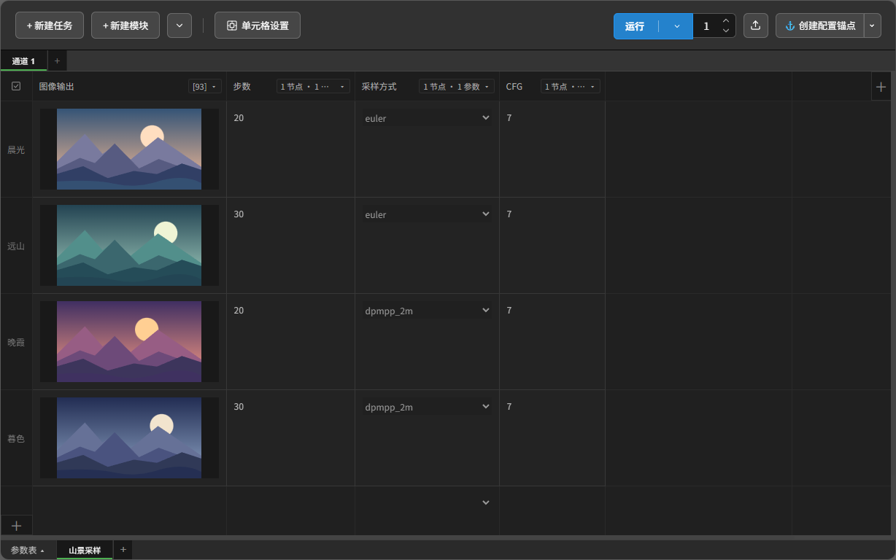

# 参数表

点击当前工作区名称旁的模式文字，选择「参数表」。同一结构的任务按行排列，每列共用模块类型和绑定，适合批量填写、粘贴和对照参数。

## 表格结构与绑定

- **表格结构**。每行对应任务、每列对应输入或输出模块。网格默认单元格为 `256 × 144`（16:9），空网格也可直接编辑、选择和调整尺寸。表头与左侧行头固定显示。右侧与底部的 `＋` 固定在视口边缘，点击在所选行、列或单元格之后插入，没有选择时在末尾添加。也可使用顶部“新建任务／新建模块”。
- **草稿与有效范围**。未绑定的列、尚未填写的行先作为草稿保存。当某行的已绑定输入列有有效取值时，建立对应任务，并将已绑定列转换为模块。`0`、`false` 同样有效。输出列需要绑定输出节点。未绑定草稿不进入运行，清空值或取消绑定会保留已有任务及历史。
- **结构对应**。相同结构的已有任务显示在同一张表。不同结构仍保留。在卡片视图选中对应任务再切换参数表，可编辑其表格。草稿与列结构随工作区保存，切回卡片仅显示实际任务和模块。
- **行列标题**。点击列标题打开列设置，可修改模块标题、切换输入／输出、批量填写取值或重置列内容。选中单元格或列头时，可通过工具栏切换整列的输入／输出类型，或使用与列设置相同的重置操作。未绑定列也支持重置。双击行头原地修改任务标题，回车确认，Esc 取消。尺寸和样式可从单元格设置单独恢复。
- **绑定摘要**。列标题固定在列头左侧，右侧摘要管理整列绑定。输入列显示节点和参数数量，输出列显示节点编号，悬停显示完整信息。未使用的列仅在悬停列头或该列单元格时显示入口。命名、绑定、修改列设置或手动调整列宽后常显。

## 选区、尺寸与排序

- **选择**。点击行头选中整行，点击列头空白处选中整列。`Ctrl/Cmd` 加选或取消，`Shift` 连选。单元格支持单选、加选与 `Shift` 矩形范围选择，也可在单元格上按住左键拖动，选择矩形范围，靠近边缘时自动滚动。Ctrl/Cmd 拖动可追加范围。普通单选、多选单元格仅显示蓝色描边。通过行头或列头选中整行、整列时，保留半透明蓝色填充。输入框不额外显示白色焦点框。
- **全选与取消选择**。左上角按钮在全选整表和取消全选间切换。按一次 `Ctrl/Cmd+A` 选中有有效取值的行与已绑定列的交集，再按一次选中整表（包括草稿格）。没有有效区时直接全选。按 `Esc`、`Ctrl/Cmd+Shift+A` 或点击表格、工具栏的空白处可取消选择。编辑文字时保留文本框的快捷键。
- **单元格设置**。从参数表工具栏打开，或右键单元格、行头、列头选择「单元格设置」。右键面板在点击位置打开，并限制在插件边界内。右键已选单元格会保留原选区。选区决定范围，空选区设置全表。列宽和行高作用于选区涉及的整列、整行，内边距和九点对齐仅作用于所选格。内边距和对齐分别取最近一次设置。内边距按上、下、左、右输入，支持逗号、空格和顿号，缺失项补零。
- **右键操作**。右键单元格可插入或删除所在的行、列。右键行头可删除上方或下方的行，或在当前行下方复制一行。右键列头可删除左侧或右侧的列，或在当前列右侧复制一列。复制会保留取值、绑定、布局和历史记录。
- **比例滑杆**。左侧可直接输入列宽和行高，右侧预览当前比例。点击预览边或尺寸标签选择调整方向，下方滑杆从竖长比例到横长比例排列，拖动时吸附到 16 个预设档位。混合尺寸时以最后选中的格为比例参考，调整值统一应用到相关行或列。预览媒体按自身比例完整显示。
- **尺寸与排序**。拖动列头右边界调整列宽，拖动行头下边界调整行高。多选行或列时，同步调整所有所选项。使用单元格设置也可统一调整选区涉及的行高或列宽。拖动行头调整行顺序。拖动单个列头与目标列交换位置，多选行、列后可整组拖动排序并保持组内顺序，绑定、值和历史跟随原行列，不额外创建行列。

## 编辑、批量取值与粘贴

- **单元格编辑**。单击选中单元格，双击或按 `F2` 编辑文本、数字。编辑时再次点击或拖动文字可正常定位光标、选择文字，`Esc` 结束编辑并保留当前值。布尔开关和固定选项菜单仍可直接点击操作，上传及媒体控件保留原操作。长文本在单元格右侧使用窄暗色滚动条。`Enter` 向下切换同列单元格，`Tab` 向右切换相邻单元格（包括输出格），`Shift＋Tab` 反向。到行末时接续下一行，结束编辑后回到选格状态，焦点与蓝色选中描边同步。编辑文本时用 `Shift＋Enter` 换行。选中输入格后按 `Delete` 清空值，保留模块与绑定。输出格只读。
- **设置取值／取值排序**。输入列复用 XY 轴的双标签与拖拽排序。结束编辑、切换排序页或按 `Ctrl/Cmd＋Enter` 后，从第一行开始应用。超出时补充草稿行。排序页可拖拽或删除取值，并同步回输入框。缩短列表仅清空上次覆盖的尾部输入，不删除任务、其他列或历史。
  - **文本与数字**。支持自动识别、换行、逗号及 JSON 数组。自动识别时文本保留行内逗号，数字支持逗号拆分。保存原输入格式。JSON 中可用 `null` 或空字符串表示空单元格。
  - **固定选项与布尔值**。列出全部选项，上方从左到右为拆分方式、全选、取消选择，数量统一显示在“取值排序”标签。排序页移除取值同步取消勾选，保留参数原始类型。
- **表格粘贴**。从 Excel 复制行、列或矩形区域后，单选一个单元格，以它为左上角按原行列排列粘贴。不足时补充草稿行列。多选时从连续矩形选区的左上角粘贴。尺寸不符时会提示，并只写入复制数据和选区重叠的范围。不连续、参数值无效或实际写入区域涉及只读输出列时取消粘贴。数字、布尔值保留参数类型，支持空单元格、带引号的多行文本及单元格内制表符。正在编辑文本或数字时，`Ctrl/Cmd＋V` 只粘贴到当前光标位置，不展开为表格。提示词中的换行、制表符按原文保留。
- **媒体粘贴**。选中已绑定媒体上传参数的输入单元格，再按 `Ctrl/Cmd＋V`。支持剪贴板中的媒体文件、截图和浏览器可读取的网页媒体。文件通过现有上传接口保存到 ComfyUI 的 `input` 目录，3D 模型保存到 `input/3d`。模块记录服务端返回的文件路径。

## 输出与运行

- **输出与运行**。媒体适配单元格的可用区域，不显示“放大预览”或未绑定提示。视频、音频和 3D 在进入可见范围时按需加载，可在格内操作。选中单元格或行后运行其所属的有效任务及全部已绑定输出。只选中空草稿时不会运行其他任务。没有选择或点击“运行全部”时，运行当前表中的有效任务。运行中的任务行以有效区外缘显示彩虹进度描边，成功时走满一圈。

[返回 README](../../README.md)
